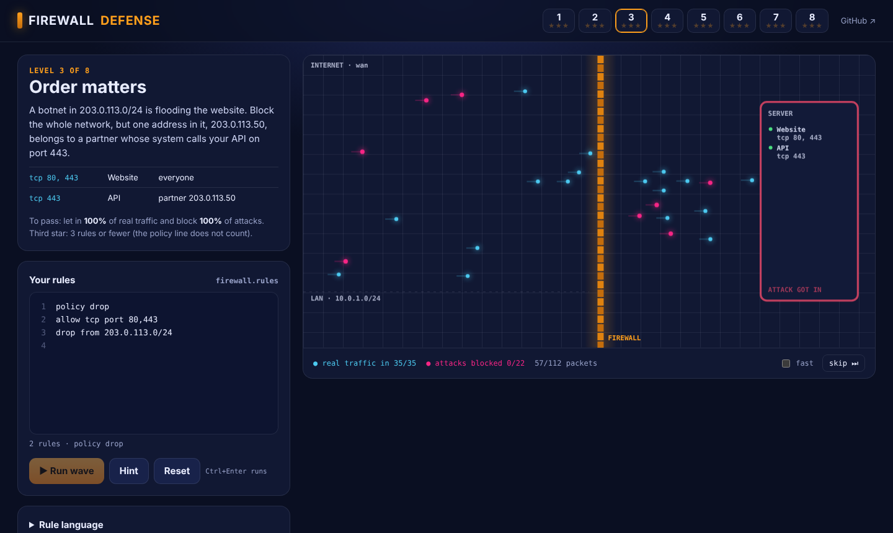
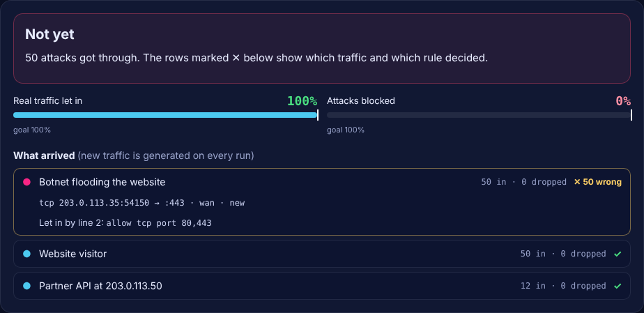

# Firewall Defense

🇷🇺 [Русская версия ниже](#ru)

**Packets are coming. Write the firewall rules that let real users in and keep attackers out.** A browser game in eight levels about how firewalls actually work: default deny, rule order, stateful filtering, spoofed addresses and rate limits.

**Play:** https://dav1dushka.github.io/firewall-defense/



## How it plays

Each level describes a server: what it offers and who may use it. You write rules in a small language modelled on iptables, press **Run**, and watch a wave of packets fly in. Blue dots are real users and magenta dots are attacks. Dropped packets burst on the wall; when an attack gets through, the server flashes red, and a blocked user leaves a yellow ✕.

After the wave, every kind of traffic is listed with what happened to it and **which line of your rules decided**, so a wrong result always points at the rule to fix.



```
# Level 8, one possible answer
allow state established                  # replies to the server's own requests
allow tcp port 443 from 203.0.113.50     # the partner, before...
drop from 203.0.113.0/24                 # ...the rest of its network
allow tcp port 80,443
allow tcp port 22 from 198.51.100.0/24   # office: no limit
allow tcp port 22 limit 3/m per-src      # everyone else: slowed down
allow tcp port 3306,6379 in lan from 10.0.1.0/24
policy drop
```

Every run generates new traffic from a fresh seed, so a ruleset cannot pass by listing the attackers' addresses: it has to describe the traffic correctly.

## The levels

| # | Level | What it teaches |
| --- | --- | --- |
| 1 | Default deny | Allow what the server offers and drop everything else, not the other way round |
| 2 | Office only | Restricting management ports (SSH) to known networks |
| 3 | Order matters | First match wins: narrow exceptions before broad rules |
| 4 | Replies welcome | Stateful filtering: `state established` instead of trusting a source port the attacker chooses |
| 5 | Keep the database inside | Databases only for the internal network |
| 6 | Spoofed insiders | Source addresses can be forged; tie them to the interface they arrive on |
| 7 | Brute force | Rate limits slow attacks down without locking users out, and the trade-off of setting them too tight |
| 8 | Production | All of it together, with an office deploy script that a careless rate limit breaks |

## Rule language

| Part | Meaning |
| --- | --- |
| `allow` / `drop` | What to do when every condition on the line matches |
| `policy drop` | What happens to packets no rule matched (starts as `allow`, like iptables) |
| `tcp` `udp` `icmp` | Protocol |
| `port 22`, `port 80,443`, `port 1024-65535` | Destination port; needs `tcp` or `udp`, as in iptables |
| `sport 53` | Source port, which the sender chooses freely |
| `from 10.0.0.0/8` | Source address or network |
| `in wan` / `in lan` | Interface the packet arrived on |
| `state new` / `state established` | Established = a reply to a connection the server opened |
| `limit 3/m per-src` | Token bucket: at most 3 matches a minute, per source address; packets over the limit skip the rule |

Mistakes get a message with the line number and a suggestion: `line 2: unknown word 'prot' (did you mean 'port'?)`.

## Code

```
src/rules.ts    parser for the rule language, with helpful errors
src/sim.ts      matching, first-match-wins evaluation, token-bucket rate limits
src/levels.ts   the eight levels and their traffic generators (seeded, repeatable)
src/ip.ts       IPv4 and CIDR maths
src/stage.ts    canvas animation
src/main.ts     editor, level select, results
tests/          node:test suites
```

The tests do more than check the parser. For every level they run a reference solution and a set of *tempting wrong answers* on 30 different traffic seeds: the solution must pass on every seed, and every wrong answer must fail on every seed. That keeps the levels fair and makes sure a lesson cannot be skipped by accident. For example, opening source port 443 must never pass level 4, and the level 5 answer must never pass level 6.

```bash
npm install
npm test           # parser, simulation and all level checks
npm run typecheck  # strict TypeScript
npm run build      # site/game.js; then open site/index.html
```

No framework, no backend: about 1,400 lines of TypeScript and one HTML file.

## Simplifications

A real firewall sees every packet of a connection; here each dot is the first packet of a connection (or a reply to one the server opened), and connection tracking is assumed rather than simulated. There is no NAT, no IPv6 and no output chain. The rule language is deliberately smaller than iptables or nftables, but every idea in it maps to one of theirs.

## License

MIT

---

<a id="ru"></a>

# Firewall Defense — по-русски

**Пакеты летят. Напиши правила файрвола, которые пропустят настоящих пользователей и остановят атакующих.** Браузерная игра из восьми уровней о том, как на самом деле работают файрволы: запрет по умолчанию, порядок правил, фильтрация с учётом состояния соединений, поддельные адреса и ограничение частоты.

**Играть:** https://dav1dushka.github.io/firewall-defense/

## Как играть

Каждый уровень описывает сервер: какие сервисы он предоставляет и кто может ими пользоваться. Ты пишешь правила на маленьком языке в духе iptables, жмёшь **Run** и смотришь, как прилетает волна пакетов. Голубые точки — настоящие пользователи, малиновые — атаки. Отброшенные пакеты разлетаются искрами о стену. Если атака прошла, сервер вспыхивает красным, а заблокированный пользователь оставляет жёлтый ✕.

После волны каждый вид трафика показан с результатом и с указанием, **какая строка твоих правил приняла решение**. Поэтому неверный результат всегда указывает на правило, которое надо исправить.

Пример решения восьмого уровня — в английской части выше.

Каждый запуск генерирует новый трафик с новым seed, поэтому нельзя пройти уровень, перечислив адреса атакующих: правила должны правильно описывать сам трафик.

## Уровни

| # | Уровень | Чему учит |
| --- | --- | --- |
| 1 | Default deny | Разрешить то, что сервер предоставляет, и отбросить всё остальное, а не наоборот |
| 2 | Office only | Доступ к портам управления (SSH) только из известных сетей |
| 3 | Order matters | Срабатывает первое подходящее правило: узкие исключения ставятся перед широкими правилами |
| 4 | Replies welcome | Фильтрация с учётом состояния: `state established` вместо доверия к порту источника, который выбирает атакующий |
| 5 | Keep the database inside | Базы данных — только для внутренней сети |
| 6 | Spoofed insiders | Адрес источника можно подделать; его надо связывать с интерфейсом, через который пришёл пакет |
| 7 | Brute force | Ограничение частоты замедляет атаку, не блокируя пользователей, и показывает, что бывает, если сделать его слишком жёстким |
| 8 | Production | Всё вместе, плюс скрипт деплоя из офиса, который ломается от неосторожного лимита |

## Язык правил

| Часть | Значение |
| --- | --- |
| `allow` / `drop` | Что сделать, если совпали все условия в строке |
| `policy drop` | Что делать с пакетами, которым не подошло ни одно правило (по умолчанию `allow`, как в iptables) |
| `tcp` `udp` `icmp` | Протокол |
| `port 22`, `port 80,443`, `port 1024-65535` | Порт назначения; нужен `tcp` или `udp`, как в iptables |
| `sport 53` | Порт источника — его отправитель выбирает сам |
| `from 10.0.0.0/8` | Адрес или сеть источника |
| `in wan` / `in lan` | Интерфейс, через который пришёл пакет |
| `state new` / `state established` | established — ответ на соединение, которое открыл сам сервер |
| `limit 3/m per-src` | Token bucket: не больше 3 совпадений в минуту с одного адреса; пакеты сверх лимита пропускают это правило |

На ошибки выводится сообщение с номером строки и подсказкой: `line 2: unknown word 'prot' (did you mean 'port'?)`.

## Код

```
src/rules.ts    парсер языка правил с понятными ошибками
src/sim.ts      сопоставление, «первое совпадение побеждает», лимиты по token bucket
src/levels.ts   восемь уровней и генераторы их трафика (по seed, воспроизводимо)
src/ip.ts       математика IPv4 и CIDR
src/stage.ts    анимация на canvas
src/main.ts     редактор, выбор уровня, результаты
tests/          тесты на node:test
```

Тесты проверяют не только парсер. Для каждого уровня они запускают эталонное решение и набор *заманчивых неправильных ответов* на 30 разных вариантах трафика. Решение должно проходить на каждом, а каждый неправильный ответ — проваливаться на каждом. Это держит уровни честными и гарантирует, что урок нельзя случайно пропустить. Например, открытый порт источника 443 никогда не проходит четвёртый уровень, а ответ пятого уровня никогда не проходит шестой.

```bash
npm install
npm test           # парсер, симуляция и проверки всех уровней
npm run typecheck  # строгий TypeScript
npm run build      # site/game.js; затем открой site/index.html
```

Без фреймворка и без бэкенда: около 1400 строк TypeScript и один HTML-файл.

## Упрощения

Настоящий файрвол видит каждый пакет соединения; здесь каждая точка — первый пакет соединения (или ответ на соединение, открытое сервером), а отслеживание соединений подразумевается, а не моделируется. Нет NAT, IPv6 и цепочки исходящего трафика. Язык правил намеренно меньше, чем iptables или nftables, но каждая идея в нём соответствует одной из их возможностей.

## Лицензия

MIT
